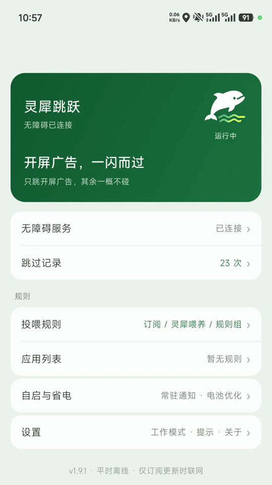

# 灵犀跳跃

> **只跳开屏广告，其余一概不碰。**
> 判断依据不是"这页能不能点"，而是"屏幕上有没有广告"。

[](https://github.com/zhaodebing/lingxi-jump/releases/latest)
[](./LICENSE)

<p align="center">
  
</p>

<p align="center"><i>首页 → 投喂规则 → 灵犀喂养：三步就有规则可用</i></p>

---

## 它做什么

在应用启动的那几秒里，找到开屏广告上的「跳过」并点掉。屏幕上哪个位置都行——左上、右下、正中间都可以。

## 它不做什么

- ❌ 不碰应用内部的按钮
- ❌ 不碰输入框、列表、搜索结果
- ❌ 不采集任何数据、不上传、不埋点
- ❌ 不需要登录、没有账号体系

## 判断依据：屏幕上有广告，才动手

无障碍树里没有"这是广告"这个字段。所以我们不看"页面叫什么名字"，而是看**屏幕上有没有广告**：

动手之前先扫一遍页面，三条正面证据满足任意一条才算：

```
① 全屏素材   有图片 / 视频 / WebView 占屏 ≥55%
② 广告标识   文本里有「广告」「点击跳转」「了解更多」这类字样
③ 控件极少   整页可点的控件只有 1~8 个，且页面不可滚动
```

三条都不成立 → 屏幕上没有广告 → **一个字都不点**。

这样「跳过」出现在屏幕任何角落都能识别，因为它不依赖位置，只依赖"这屏是不是广告"。

## 同时保留的否决项

每一条都对应一个真实踩过的坑：

| 否决项 | 对应场景 |
|---|---|
| 输入框里的字 | 知乎搜索框里打的「跳过」 |
| 可滚动容器里的字 | 酷安首页的「跳过」分类标签 |
| 整屏容器不是按钮 | 广告层的根容器 |
| 控件不可用 | 禁用状态的按钮，点了没反应 |
| 类名黑名单 | search / setting / detail / web / login / chat / player / comment |

## 三个和同类不一样的地方

**1. 点了会回头看一眼**

引擎判断"成功"的依据只是"点击动作发出去了"。但广告 SDK 的按钮经常是**点得到、不响应**，于是同类工具会出现"实际没跳过，却弹了已跳过提示"。

我们点完等 500ms，重新查同一个窗口里「跳过」还在不在：还在就**不弹提示、不计数**。

**2. 次数一定用掉，不会连点**

每次动手无论成没成，都会把这一屏的机会用掉。所以不会出现"对着同一处连戳八次"——这是之前踩过的坑，写在这儿提醒自己。

**3. 灵犀喂养：你自己填词，不用懂规则**

订阅规则覆盖不到的应用，填个词就行：

```
跳过
```

它会自动展开成「跳过 / 跳过3 / 跳过 3 / 跳过 5s / 跳过(3)」这些常见写法，并主动排掉
「跳过联网 / 跳过片头 / 跳过引导 / 跳过登录」这类**别的功能**。

## 快速开始

### 1. 安装

从 [Releases](https://github.com/zhaodebing/lingxi-jump/releases/latest) 下载 `lingxi-jump-x.y.z.apk`，安装。

> 包名 `li.songe.gkd`，与官方 GKD 不能共存，装之前请先卸载或二者择一。

### 2. 开无障碍

打开应用 → 首页「无障碍服务」→ 按引导到系统设置里勾选「灵犀跳跃」。

### 3. 让它有规则可选

两条路，任选或都用：

| 方式 | 适合 | 怎么做 |
|---|---|---|
| **订阅规则** | 想一步到位 | 投喂规则 → 右下角 `+` → 粘贴 GKD 订阅链接 |
| **灵犀喂养** | 不想折腾订阅 | 投喂规则 → 灵犀喂养 → 填「跳过」 |

### 4. 结束

打开任意有开屏广告的应用，0.3 秒左右广告会自己消失。

## 兼容性

- 规则格式与 [GKD](https://github.com/gkd-kit/gkd) 订阅兼容，现有订阅可直接导入
- 需要 Android 8.0 及以上
- 不需要 root；用无障碍即可，也可以配合 Shizuku / ADB 使用

## 已知边界

- **自绘开屏**（酷安、腾讯视频那种画面自己画的）经常既没有文字也没有控件 id，文字规则够不着——这类交给订阅规则
- **引导页**可能被误判成广告页（它也有全屏图和极少按钮）。遇到请提 issue 告知应用名

## 常见问题

**Q：装了没反应？**
先确认首页「无障碍服务」显示"已连接"；MIUI / ColorOS 还需要允许"后台弹出界面"与"自启动"。

**Q：会不会误点应用内部的「跳过」？**
不会。判定是"有广告才动手"，再加上输入框/列表/整屏容器三道否决。

**Q：为什么通知栏一直有一条？**
前台服务通知，用来保证服务不被系统杀掉。可以在「自启与省电 → 常驻通知」里关掉。

**Q：可以只用 Shizuku 吗？**
可以。设置 → 连接方式 → 工作模式 → 自动化。

## 校验

```bash
# 2.2.1
sha256sum lingxi-jump-2.2.1.apk
# 444591d1a9b8ca1f475963cc32fb280f45e3c125790b095d8eba0b4acd343a2f
```

## 许可与归属

- 本项目基于 [gkd-kit/gkd](https://github.com/gkd-kit/gkd) 1.13.2 二次开发，以 **GPL-3.0-only** 分发，见 [LICENSE](./LICENSE)
- 上游名称「GKD」及其商标不属于本项目，不用于宣传本衍生作品
- 与上游的差异说明见 [SOURCE-README.md](./SOURCE-README.md)

## 隐私

不采集设备信息、不埋点、不上报任何数据。唯一的联网行为是你手动添加订阅并点「更新」时访问该链接。
触发记录、规则、设置全部保存在本机。

## 赞赏

完全免费，功能不加锁。应用内「关于 → 支持」有赞赏入口，不赞赏同样完整可用。

公众号：**趣味暖心**（更新说明、规则变动、踩过的坑都发在这里）
